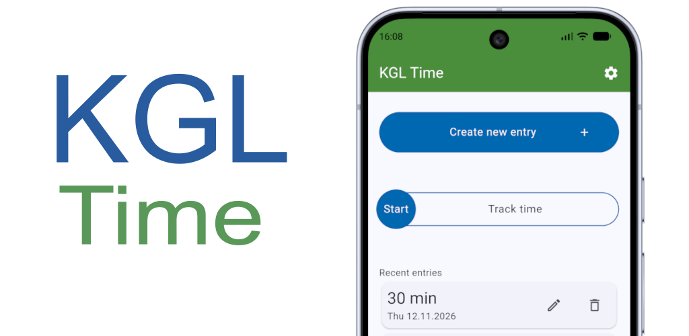
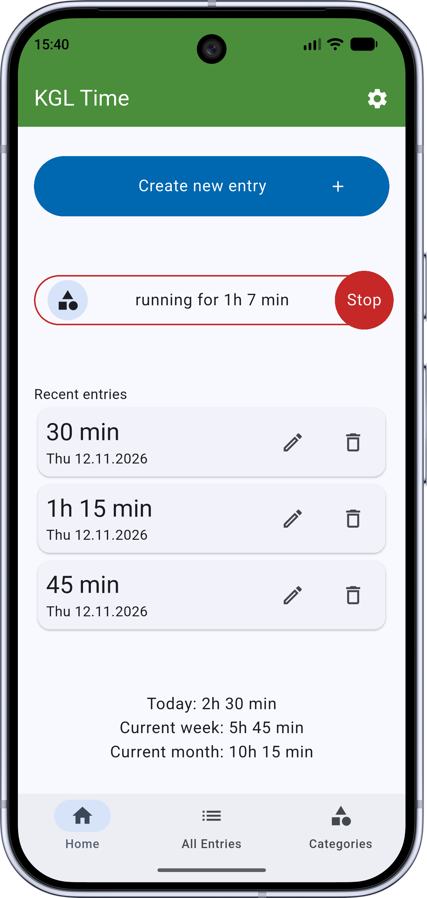
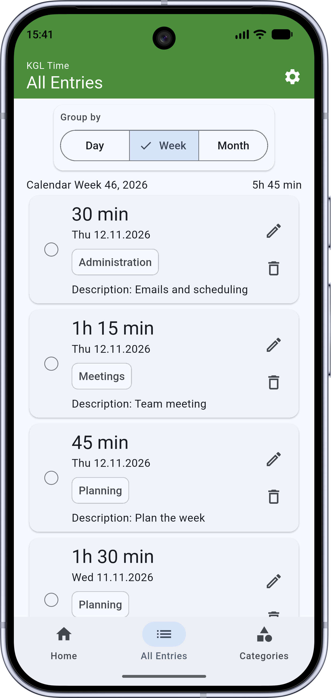
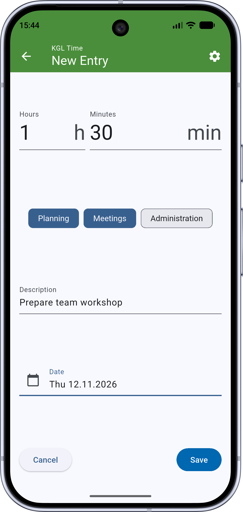
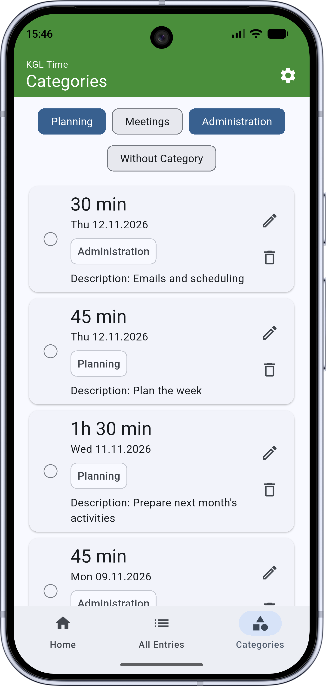

# KGL Time

A simple time tracking app designed to help users manage their work hours efficiently. Developed
with Flutter, the app stores work hours locally on your device and requires no account.

<a href="https://play.google.com/store/apps/details?id=com.wi42.kgl_time">
  
</a>

<p>
  
</p>

## Features

- **User-friendly Interface**: Easy to navigate and track work hours.
- **Light and Dark Themes**: Choose your preferred theme or follow your device’s system setting.
- **Local Storage**: Work entries, categories, and settings are stored on your device.
- **Backup and Restore**: Save or share JSON backups of all work entries and categories and restore
  them when needed.
- **No Registration Required**: Users can start tracking time immediately without the need for accounts or logins.

<p>
  <a href="demo_images/phone/demo_en/1_Screenshot_kgl_time_startpage_en.png"></a>
  <a href="demo_images/phone/demo_en/2_Screenshot_kgl_time_all_entries_en.png"></a>
  <a href="demo_images/phone/demo_en/3_Screenshot_kgl_time_new_entry_en.png"></a>
  <a href="demo_images/phone/demo_en/4_Screenshot_kgl_time_categories_en.png"></a>
</p>

## Privacy Policy

KGL Time stores work data locally and does not automatically transmit it to the developer. The app
contains no embedded analytics or advertising. You can export or share data at your request, and
app data may be included in operating system backups. See [PRIVACY.md](PRIVACY.md) for details.

## License

Copyright © 2024–2026 Lukas Künzi.

KGL Time is licensed under
the [GNU General Public License](https://www.gnu.org/licenses/gpl-3.0.html),
version 3 or (at your option) any later version (`GPL-3.0-or-later`). See [LICENSE](LICENSE) for the
full license text.

## Platform Compatibility

The app can, in principle, be built for all platforms that Flutter provides, except for the web.
However, the application has only been tested on **Android**, **Linux** and **Windows**.

## Getting Started

1. **Clone the Repository**: Use the following command to clone the repository:
   ```bash
   git clone https://github.com/Wii42/kgl-time.git
   ```

2. **Install Dependencies**: Navigate to the project directory and install the required dependencies:
   ```bash
   cd kgl-time
   flutter pub get
   ```

3. **Run the Project**: Start the application using:
   ```bash
   flutter run
   ```
   or build the APK for Android:
   ```bash
   flutter build apk
   ```

## Code Generation

To automatically regenerate code when source files change, run the following command from the
project root in a separate terminal:

```bash
dart run build_runner watch --delete-conflicting-outputs
```

## Changelog

See [CHANGELOG.md](CHANGELOG.md) for the full release history.

<!-- Keep these version headings for release-note links in older app versions. -->

### v0.4.1

See the [release notes](CHANGELOG.md#v041).

### v0.4.0

See the [release notes](CHANGELOG.md#v040).

### v0.3.6

See the [release notes](CHANGELOG.md#v036).

### v0.3.5

See the [release notes](CHANGELOG.md#v035).

### v0.3.4

See the [release notes](CHANGELOG.md#v034).

## Contact

For any questions about KGL Time or this project, please reach out via the provided email address:

- **Lukas Künzi**: [wi42.dev@gmail.com](mailto:wi42.dev@gmail.com)
- **Website**: [https://wi42.dev](https://wi42.dev)
